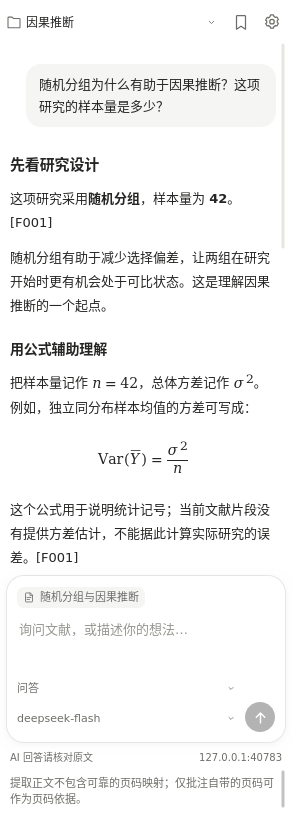
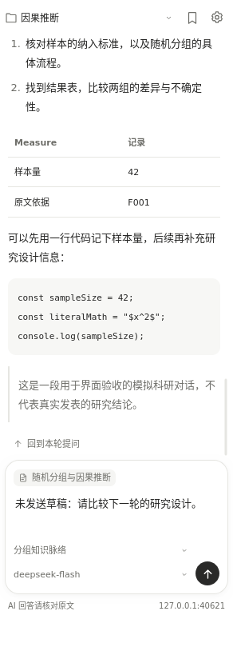

# LitThread · 研脉

**Read a paper. Follow a research thread.**

[中文](README.md) · [User guide (Chinese)](docs/USER_GUIDE.md) · [Testing](docs/TESTING.md) · [Changelog](CHANGELOG.md)

LitThread is an AI reading companion for Zotero. Ask questions beside a paper, save useful answers as notes, claims and evidence, and maintain a research memory for each collection.

Notes and memory are local files. AI requests use your configured API provider and your own key. DeepSeek is the primary integration; the interface is currently primarily Chinese.

<p>
  
  
</p>

Screenshots use synthetic papers, answers and account balances in an isolated test library. See the responsive [narrow](docs/images/sidebar-narrow.png) and [wide](docs/images/sidebar-wide.png) sidebar layouts.

## Features

- Read collection membership and inspect local attachment paths.
- Ask about the current paper, selected passages and annotations from Zotero's main-window reader sidebar.
- Choose a model and task beside the composer; manage API settings on a separate page.
- Adapt to sidebar width changes and jump from each completed answer to its corresponding question.
- Display Markdown and local LaTeX formulas using `$…$`, `$$…$$`, `\(...\)` and `\[…\]`.
- Save literature notes, claim cards and evidence cards with tags and request-specific source packets.
- Generate collection research outlines and explicitly save them as `memory.md`, backing up the previous version.
- Export Markdown / JSON inventories and manually query an official DeepSeek account balance.

## Install

Version **0.3.4** declares compatibility with **Zotero 7.0–10.0.x**. Declared compatibility is not a guarantee of testing on every platform; see [test coverage](docs/TESTING.md).

This version passed 115 unit tests, 70 native checks on each of Linux Zotero 7.0.32 and 10.0.7, and 31 hot-upgrade checks. Windows and macOS have not been tested natively.

1. Download `zotero-litthread-0.3.4.xpi` from the [v0.3.4 Release](https://github.com/Ghostvulture/zotero-litthread/releases/tag/v0.3.4), or build it using the commands below.
2. Open Zotero's plugin manager under **Tools**, then use **Install Add-on From File** or drag the XPI into the manager.
3. Select a paper or open its PDF in a **main-window tab**, then expand the assistant section in the right sidebar.

Node.js and Python are not required to use an XPI. Zotero 7's standalone reader window does not provide this sidebar.

**Upgrading from Research Companion:** install the new XPI over the old version. The add-on ID, preferences and data directories are unchanged. There is no need to uninstall. Updates are currently manual; the reserved `.invalid` manifest URL is not an update service.

## Start reading

Open the gear menu, set the API base URL (for example `https://api.deepseek.com`), key and a model available to your account. Save and test the connection. Only a root base URL or `/v1` is supported; do not paste the full `/chat/completions` endpoint.

Select a collection at the top. Select text in the PDF and click **问研脉**, then ask your question. Press **Ctrl / ⌘ + Enter** to send. Model choices are configured locally; availability depends on your provider. Responses are displayed when complete, with a 120-second request timeout.

Use the bookmark icon to save a checked answer as a note, claim or evidence card. The research-outline task uses the collection's metadata, existing memory and recent cards; saving the resulting memory requires an explicit click.

## Local files and API data

The default storage root is `<Zotero data directory>/research-companion/`, followed by `library-<ID>/collection-<key>/`. The legacy directory name preserves upgrade continuity. Each collection has its own memory, cards, conversation files and backups. A custom root can be selected, but existing files are not moved automatically.

These extra files do not automatically participate in Zotero sync and are not deleted when the plugin is removed.

Clicking Send transmits selected research context to the configured API provider: the question, relevant extracted text, selections, annotations, bounded history and memory. Outline requests also include limited collection metadata. There is no automatic whole-library upload or telemetry. Keys are stored in Zotero's login manager where available, otherwise only for the session.

Current limits:

- Keyword-based excerpts, not whole-library vector search or automatic citation-network traversal.
- No OCR or image understanding. Extracted tables and formulas can be imperfect.
- Source labels such as `[F001]` refer to a request-specific packet, not PDF page numbers.
- Remote images are not loaded; links only open when clicked. Code blocks retain literal TeX.
- Inventory exports intentionally contain local attachment paths; review them before sharing.
- Windows and macOS native execution and a real DeepSeek account have not been verified in the local test environment.

## Development

Requires **Node.js 18+** and **Python 3.8+**. No `npm install` is needed; KaTeX is vendored with its license and provenance.

```bash
npm test
python3 scripts/build.py
```

On Windows, `py -3 scripts/build.py` is also available where Python's launcher is installed. The build writes the XPI, source ZIP and `SHA256SUMS.txt` to `dist/`. Tests use fixtures, not a real API account.

See [CONTRIBUTING.md](CONTRIBUTING.md) for development and bug reports, and [docs/PUBLISHING.md](docs/PUBLISHING.md) for setting up the GitHub repository and releasing the XPI. Do not include keys or private papers in public reports.

## License

[MIT](LICENSE). The original Research Companion contributors notice is retained. KaTeX 0.19.1 is also MIT licensed; see [third-party notices](THIRD_PARTY_NOTICES.md).

LitThread is an independent community project, not an official Zotero, DeepSeek or OpenAI product.

Collection comparisons in chat now include bounded local excerpts from up to six other direct members of the selected collection, with coverage and missing-text status. Collection memory remains a separately saved synthesis, not a cache of every paper.
