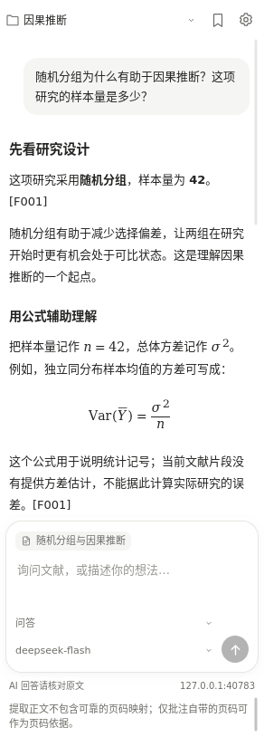
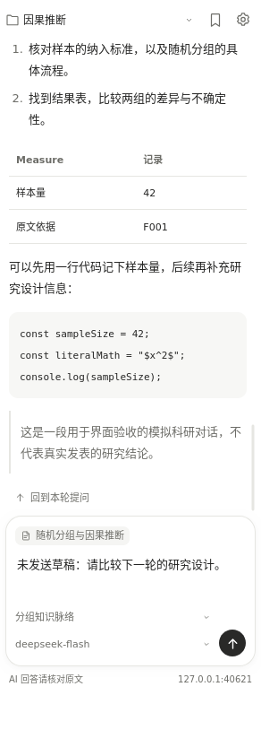

# LitThread · 研脉

**读懂一篇文献，串起一个研究方向。**

[English](README.en.md) · [使用指南](docs/USER_GUIDE.md) · [测试记录](docs/TESTING.md) · [更新日志](CHANGELOG.md)

LitThread 是一个面向 Zotero 的 AI 阅读与知识积累插件。在文献旁边提问，把有价值的回答整理成笔记、观点和证据，再按分组维护自己的研究脉络。

**Lit** 来自 literature，**Thread** 既是对话，也是贯穿文献的线索。中文名「研脉」，取研究脉络之意。

文献与知识文件保存在本地；AI 问答使用你配置的 API，需要自己的 Key。当前优先接入 DeepSeek，界面以中文为主。

## 看看界面

<p>
  
  
</p>

截图来自隔离测试文献库，论文、回答及余额均为合成数据。查看[窄侧栏](docs/images/sidebar-narrow.png)／[宽侧栏](docs/images/sidebar-wide.png)的自适应效果，或阅读[测试记录](docs/TESTING.md)。

## 能帮你做什么

| 阅读环节 | 功能 |
| --- | --- |
| 找到材料 | 浏览 Zotero 分组及其直接成员，查看本地附件路径，在文件管理器中定位已下载文件。 |
| 读懂论文 | 在主窗口 PDF 标签页右侧提问，把选中的段落加入上下文；回答结合可提取正文、批注与对话历史。 |
| 顺手对话 | 底部选择任务和模型；设置独立成页。侧栏宽度变化时调整布局，每条完整回复可一键返回对应提问。 |
| 看清表达 | 显示 Markdown 标题、列表、表格、代码和 LaTeX 公式。支持 `$…$`、`$$…$$`、`\(...\)`、`\[…\]`。 |
| 留下积累 | 将回答保存为「文献笔记 → 观点卡片 → 论证素材」，附标签、文献信息与本次来源材料包。 |
| 梳理方向 | 结合分组目录、已有 memory 和近期卡片生成知识脉络草稿，由你检查并保存为 `memory.md`。 |
| 衔接工具 | 导出 Markdown / JSON 文献目录；本地知识文件可交给编辑器、笔记软件或自己的脚本继续处理。 |
| 管理 API | 配置 API 地址、Key 和模型列表；手动查询 DeepSeek 官方账户余额。 |

## 安装与升级

当前版本：**0.3.3**。插件清单允许 **Zotero 7.0–10.0.x** 安装。

本版通过 115 项单元测试，Linux Zotero 7.0.32 / 10.0.7 各通过 70 项原生检查，以及 31 项覆盖升级检查。Windows / macOS 尚未原生实测。

1. 准备 `zotero-litthread-0.3.3.xpi`：可使用发行包附带的 XPI，或按下方步骤自行构建。发布者可将它上传到 GitHub Releases。
2. 在 Zotero 打开 **工具 → 插件**，通过齿轮菜单选择 **从文件安装插件**，选中 XPI；也可以拖入插件窗口。
3. 在 Zotero **主窗口**选择文献，或在主窗口标签页打开 PDF，展开右侧 **研脉 · 科研助手**。

使用 XPI 不需要安装 Node.js 或 Python。[Zotero 官方插件说明](https://www.zotero.org/support/plugins)。

**从 Research Companion 升级：直接安装新版 XPI，无需卸载旧版。** LitThread 是该项目的新名称，沿用原插件 ID、设置和数据目录。安装后在插件管理器核对版本号；若侧栏暂未刷新，重新打开阅读标签页或重启 Zotero。

当前采用手动文件更新；尚未部署在线更新服务。不要把清单中的保留域名 `research-companion.invalid` 当作下载地址。

## 五分钟开始

1. **设置连接。** 点击侧栏右上角齿轮，API 基础地址使用 `https://api.deepseek.com`，填写自己的 API Key 和账户可用的模型名称，保存并点击「测试连接」。也接受以 `/v1` 结尾的基础地址。
2. **选择分组。** 在侧栏顶端选择本次学习所属的 Zotero 分组；每个分组维护独立 memory。
3. **问一个具体问题。** 在 PDF 中选中文字，点击「问研脉」，再问“这段推导依赖哪些假设？”或“这里的证据能支持什么结论？”。也可直接输入问题。
4. **留下可复用内容。** 从任务菜单生成文献笔记、观点卡片或论证素材，检查后点击保存图标，填写标签并保存。
5. **整理研究脉络。** 选择「分组知识脉络」生成草稿，核对后保存为 memory。后续阅读会使用已有 memory 的一部分作为上下文。

输入框按 **Ctrl / ⌘ + Enter** 发送，Enter 换行。底部模型选择用于下一次请求；设置页可以维护候选列表。模型名称由服务商决定，预置项不保证你的账户有权限使用。

## 知识保存在哪里

默认位于 Zotero 数据目录下：

```text
research-companion/
└── library-<libraryID>/collection-<collectionKey>/
    ├── memory.md          # 经你确认保存的研究脉络
    ├── notes/             # 文献笔记
    ├── claims/            # 观点卡片
    ├── evidence/          # 论证素材
    ├── conversations/     # 当前分组下各文章的对话
    ├── backups/           # 替换 memory 前的备份
    └── records.json       # 卡片索引
```

每张卡片还会保存对应的 `.sources.json` 材料包。目录名沿用 `research-companion`，方便旧版直接升级。你也可以在设置中指定根目录；**切换目录不会自动搬运原文件**。

这些文件不自动加入 Zotero 同步，卸载插件也不会删除它们。完整目录规则、迁移方式和读取预算见[使用指南](docs/USER_GUIDE.md)。

## 数据与当前边界

- **AI 请求会发送研究材料。** 点击发送后，问题、相关正文片段、选段、批注、部分历史和 memory 等会交给你设置的 API 服务商；分组知识脉络还包含有限的分组目录。插件没有自动整库上传或遥测。
- **Key 保存在本机 Zotero 登录管理器。** 不可用时仅保留于会话；Key 不写入知识文件。不要把 Key 或私有论文贴到公开 Issue。
- **当前是有限片段检索。** 根据问题关键词选择文本，不是整库向量检索，也不会自动追踪引用／被引网络。回答中的 `[F001]` 是本次材料编号，不是 PDF 页码。
- **没有 OCR 或图片理解。** 扫描件需先做 OCR；论文中的表格和公式仍可能提取错序。AI 回答需要对照原文核实。
- **响应生成完后一次显示。** 当前不支持流式输出；单次请求超时为 120 秒。
- **平台支持与验证分开说明。** 目标是 Windows、Linux、macOS 共用一份 XPI；实际运行结果和未验证环境见[测试记录](docs/TESTING.md)。Zotero 7 独立阅读窗口没有此侧栏，请使用主窗口的 PDF 标签页。

导出的文献目录包含本机附件路径；分享前按需移除。更完整的数据流说明见[使用指南](docs/USER_GUIDE.md)。

## 开发与构建

需要 **Node.js 18+** 和 **Python 3.8+**；无需 `npm install`。JavaScript 运行依赖已随仓库提供，测试使用模拟 API。

在仓库根目录运行：

```bash
npm test
python3 scripts/build.py
```

Windows 没有 `python3` 命令时，可使用 `py -3 scripts/build.py`。生成文件位于 `dist/`：

```text
dist/
├── zotero-litthread-0.3.3.xpi
├── zotero-litthread-0.3.3-source.zip
└── SHA256SUMS.txt
```

```text
bootstrap.js        Zotero 插件生命周期
modules/app.js      侧栏、设置与交互
modules/data.js     分组、附件与正文读取
modules/ai.js       材料组织与 API 调用
modules/memory.js   卡片、对话、memory 与备份
modules/markdown.js Markdown 与公式定界符
modules/math.js     本地 LaTeX → MathML
vendor/katex/      内置公式引擎、原许可证和来源信息
tests/             单元测试及 Zotero 原生检查
scripts/           测试和打包入口
docs/              使用、测试和发布说明
```

## 参与改进

欢迎报告问题或提交 PR。请提供操作系统、完整 Zotero 版本、插件版本和复现步骤；Windows / macOS 的实际使用反馈尤其有帮助。提交方法见 [CONTRIBUTING.md](CONTRIBUTING.md)。

首次建立 GitHub 仓库和发布 XPI 的步骤见[发布指南](docs/PUBLISHING.md)。

## 许可证与致谢

项目采用 [MIT License](LICENSE)，保留原 Research Companion contributors 的版权声明。内置 KaTeX 0.19.1 同样采用 MIT，其原许可证保存在 [vendor/katex/LICENSE](vendor/katex/LICENSE)，来源与校验信息见 [THIRD_PARTY_NOTICES.md](THIRD_PARTY_NOTICES.md)。

LitThread 是独立社区项目，与 Zotero、DeepSeek 或 OpenAI 没有官方隶属关系。
